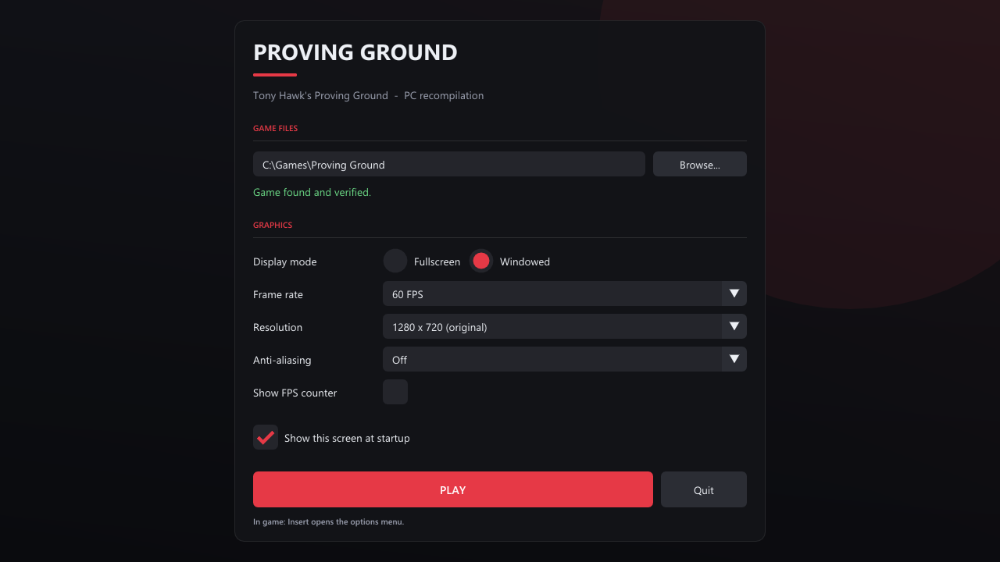

<p align="center">
  
</p>

<h1 align="center">Proving Ground Recompiled</h1>

<p align="center">
  A native PC port of <b>Tony Hawk's Proving Ground</b>, statically recompiled from the Xbox 360 version.<br>
  Windows and Linux. Bring your own copy of the game.
</p>

<p align="center">
  
</p>

## Features

- **Runs natively.** The game's PowerPC code is translated ahead of time to C++ with the
  [ReXGlue SDK](https://github.com/rexglue/rexglue-sdk) and rendered through Vulkan. No
  emulator is involved at runtime.
- **High frame rates.** 30 FPS (original), 60, 120, 144, 165, 240 or unlimited. Cutscenes,
  menus and gameplay keep their original speed at any frame rate.
- **Higher resolutions.** Render at 1440p or 4K, with optional FXAA.
- **Launcher and in-game menu.** Choose the game folder and the options before you play.
  **Insert** opens the options while playing. Settings are saved.
- **Your files stay yours.** No game code or data is distributed. The launcher checks that
  your `default.xex` is the version the build was made for.

## Playing

1. Download the latest release for your system from the
   [Releases](../../releases) page and unzip it.
2. Extract your Xbox 360 disc of Tony Hawk's Proving Ground (an ISO dumped from your own copy)
   to a folder. It must contain `default.xex`.
3. Start `ProvingGround.exe` (Linux: `ProvingGround`), choose that folder and press **PLAY**.

See [docs/PLAYING.md](docs/PLAYING.md) for the options, controls, file locations and
troubleshooting.

### Supported version

The code is generated from one specific executable:

| File | Size | SHA-1 |
| --- | --- | --- |
| `default.xex` (Xbox 360 disc, NTSC-U/PAL) | 10,366,976 bytes | `ea1848544ad48e9b59e089bc0066a6b271e126ba` |

Other versions are detected and may not work.

### Requirements

- Windows 10 or 11 (64-bit), or a 64-bit Linux distribution with a desktop
- A Vulkan-capable GPU and an up-to-date driver
- A CPU with SSE4.2 (any x86-64 CPU from about 2010 onward)
- A controller is recommended

## Building

```powershell
.\build.ps1
```

```bash
./build.sh
```

Put your extracted game in `assets/` first; the code generator needs `assets/default.xex`.
The scripts fetch ReXGlue v0.10.0, apply [`patches/rexglue-sdk.patch`](patches/rexglue-sdk.patch),
generate the code and build the game into `out/dist`. See [docs/BUILDING.md](docs/BUILDING.md)
for requirements and options.

## Status

The game boots, plays and runs its cutscenes at the right speed on Windows. The Linux build
compiles and starts, but gameplay on Linux has not been tested yet. Nothing has been validated
end to end (a full career, every level, online modes). Online play is not supported. Please open an issue with your log (`logs` next to the executable) if something
breaks.

Developer documentation: [frame pacing, performance tools and profiling](docs/DEVELOPMENT.md),
[porting to other platforms](docs/PORTING.md).

## Credits

- [SunJaycy](https://github.com/SunJaycy) started the
  [original ProvingGroundRecomp](https://github.com/SunJaycy/ProvingGroundRecomp) project,
  including the function hints this build still uses.
- The [ReXGlue SDK](https://github.com/rexglue/rexglue-sdk) team and the
  [Xenia](https://github.com/xenia-project/xenia) project, whose work the runtime builds on.
- The Tony Hawk's Project 8 recompilation project, for the vblank deadline wait adapted
  in the SDK patch.

## Legal

This project is not affiliated with or endorsed by Activision, Neversoft or Microsoft.
Tony Hawk's Proving Ground and all related trademarks belong to their respective owners. This
repository contains no game code, data or assets; you need your own legally obtained copy of
the game. The source code is under the [MIT license](LICENSE); see
[THIRD_PARTY_NOTICES.md](THIRD_PARTY_NOTICES.md) for the components it builds on.
